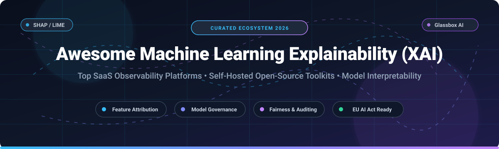

# Awesome-Machine-Learning-Explainability-XAI

  

  
  
  
  
  
  
  

---

## 🔍 Top Machine Learning Explainability (XAI) Ecosystem

> **A curated, battle-tested list of leading SaaS observability platforms & open-source GitHub frameworks for Machine Learning Explainability (XAI), Model Interpretability, Feature Attribution, and AI Governance.**

**Last updated:** October 2026 🚀

Machine Learning Explainability (XAI) empowers data science teams, ML engineers, compliance auditors, and enterprise executives to unpack "black-box" models. By understanding *why* models generate particular predictions, organizations can detect algorithmic bias, surface critical feature drivers, satisfy stringent regulatory standards (such as the **EU AI Act**, **GDPR Right to Explanation**, and **ECOA/Fair Lending** guidelines), and debug complex data drift issues before deploying to production.

---

## 📑 Table of Contents

- [📊 Sector Overview & Market Dynamics](#-sector-overview--market-dynamics)
- [☁️ SaaS & Hosted Platforms](#️-saas--hosted-platforms)
- [🛠️ Open-Source GitHub Projects](#️-open-source-github-projects)
- [🤝 How to Contribute](#-how-to-contribute)
- [💖 Support](#-support)
- [⭐ Star History](#-star-history)
- [⚠️ Disclaimer](#️-disclaimer)

---

## 📊 Sector Overview & Market Dynamics

The global Explainable AI (XAI) and ML interpretability market is estimated at **$9.2B–$11.1B in 2025–2026**, growing at a CAGR of ~18–20% driven by enterprise regulatory compliance (such as the EU AI Act and financial fair-lending mandates). The sector is **moderately fragmented** overall: major cloud hyperscalers (AWS SageMaker Clarify, Azure ML, Google Vertex AI Explainable AI) hold a concentrated top tier, while independent platforms and open-source ecosystems compete dynamically through deep domain diagnostics, governance templates, and specialized attribution toolkits.

---

## ☁️ SaaS & Hosted Platforms

| Product | Company Size (Valuation / Revenue) | Description | Pricing | Free Tier Limit |
| :--- | :--- | :--- | :--- | :--- |
| **[DataRobot](https://www.datarobot.com/)** | **$6.3B valuation** (~$250M ARR) | Automated ML and governance platform with native prediction explanations, feature impact, and model interpretation pipelines. | Starts at **$25,000/year** (custom annual subscriptions based on active user seats, compute AI units, and production deployments). | **30-day free trial** with full platform access (capped at shared modeling workers, ~1,000 LLM calls, and 15 vector DBs). |
| **[H2O.ai](https://h2o.ai/)** | **$1.7B valuation** (~$75M ARR) | Enterprise AI platform featuring Driverless AI with automated machine learning interpretability (reason codes, surrogate models, Shapley values). | Starts at **$25,000/year** (single-node BYOL license; multi-node and H2O AI Cloud typically $75k–$100k+/year). | **21-day free trial** license key for Driverless AI (full feature access; self-hosted or BYOL on cloud infrastructure) + permanently free open-source H2O-3. |
| **[Arize AI](https://arize.com/)** | **$915M valuation** (~$30M ARR; Acquired by Dynatrace) | AI observability and LLM evaluation platform with explainability workflows for tabular, computer vision, and unstructured models. | **AX Free**: $0/mo. Paid tier starts at **$50/month** (AX Pro, includes 50k spans/mo and 10 GB ingestion). Enterprise offers custom VPC deployment. | **Free forever plan**: 25k spans/month, 1 GB ingestion volume, 15-day data retention, unlimited users, Alyx AI assistant. |
| **[Fiddler AI](https://www.fiddler.ai/)** | **~$200M valuation** (~$30M ARR; $30M Series C) | Model performance monitoring and explainable AI platform with unified metrics for data drift, game-theoretic attributions, and bias tracking. | Developer tier starts at **$0.002 per trace**; enterprise production monitoring plans start around **$1,500/month** ($18,000/year). | **Free plan** for real-time safety guardrails & evaluations; plus **30-day free trial** on AWS Marketplace (SageMaker Partner AI App) supporting up to 5 models. |
| **[Arthur AI](https://www.arthur.ai/)** | **~$45M valuation** (~$5M ARR) | AI governance and monitoring platform with built-in model explainability, fairness audits, and counterfactual "What-If" scenario analysis. | **Free**: $0/mo. Paid tier starts at **$60/month** (Premium tier). Custom pricing for Enterprise VPC/SSO. | **Free forever plan**: 2 projects, 1 workspace, 300k spans/month, 12,000 model inferences/month, 7-day data retention, unlimited seats, 3 custom alerts/model. |
| **[WhyLabs](https://whylabs.ai/)** | **~$37M valuation** (~$10M ARR; Acquired) | AI observability and model profiling platform utilizing statistical profiling (whylogs) to track data drift and feature distribution changes. | **Free & Open Source** (Platform open-sourced under Apache 2.0). Legacy SaaS on AWS Marketplace starts at **$100/month** (for 2 models; $200/mo for 3 models). | **Entire platform is 100% free forever and open-source** (self-hostable Apache 2.0 without tier limits or explanation caps). |

---

## 🛠️ Open-Source GitHub Projects

Curated self-hosted toolkits, glassbox algorithms, and feature attribution libraries sorted descending by GitHub Stars_Count:

1. **[SHAP](https://github.com/slundberg/shap)**   
   **The game-theoretic attribution standard.** Implements Shapley values from cooperative game theory to assign each feature a contribution to predictions—theoretically grounded, consistent, and model-agnostic (tree models, neural nets, linear models). Features tree SHAP accelerations for XGBoost, LightGBM, and CatBoost, alongside rich force plots, summary plots, and dependence plots.

2. **[LIME](https://github.com/marcotcr/lime)**   
   **The original local surrogate explanation framework.** Explains individual predictions of any black-box classifier or regressor by learning an interpretable local surrogate model (linear regression or decision tree) around perturbed instances. Ideal for quick qualitative sanity checks on tabular, NLP text, and image classifications.

3. **[Cleanlab](https://github.com/cleanlab/cleanlab)**   
   **Data-centric AI and label interpretability.** Finds and fixes label errors, out-of-distribution instances, and data issues across tabular data, text, and computer vision datasets with confident learning algorithms. Essential for interpreting why models fail due to bad training annotations.

4. **[InterpretML](https://github.com/interpretml/interpret)**   
   **Microsoft's unified glassbox and blackbox toolkit.** Features the **Explainable Boosting Machine (EBM)**—an inherently interpretable generalized additive model (GA2M) matching gradient boosting accuracy while exposing exact pairwise interactions. Also exposes a unified API covering SHAP, LIME, and partial dependence plots.

5. **[Adversarial Robustness Toolbox (ART)](https://github.com/Trusted-AI/adversarial-robustness-toolbox)**   
   **Model robustness and adversarial interpretability library.** Developed under the Linux Foundation / IBM, ART provides tools to evaluate model vulnerability against evasion, extraction, and poisoning attacks, interpreting neural network decision boundaries under adversarial perturbation.

6. **[Captum](https://github.com/pytorch/captum)**   
   **PyTorch-native model interpretability library.** Created by Meta, Captum provides state-of-the-art attribution algorithms tailored specifically for PyTorch deep learning models, including Integrated Gradients, DeepLIFT, Grad-CAM, Saliency, Shapley Value Sampling, and Noise Tunneling.

7. **[Shapash](https://github.com/MAIF/shapash)**   
   **Interactive XAI dashboards for data scientists and business stakeholders.** Built by MAIF, Shapash wraps SHAP and Lime to generate clear, intuitive web applications and report summaries that bridge technical explainability outputs into clear business decision narratives.

8. **[AI Fairness 360 (AIF360)](https://github.com/Trusted-AI/AIF360)**   
   **Comprehensive toolkit for algorithmic fairness and bias interpretation.** Maintained by IBM and the LF AI & Data Foundation, AIF360 implements over 70 fairness metrics and 10 bias mitigation algorithms across pre-processing, in-processing, and post-processing stages.

9. **[ELI5](https://github.com/TeamHG-Memex/eli5)**   
   **Lightweight debugging and inspection library.** Python framework designed to "Explain Like I'm 5"—inspecting feature weights, scikit-learn pipelines, decision paths, XGBoost/LightGBM trees, and text highlighting for NLP models.

10. **[Alibi Explain](https://github.com/SeldonIO/alibi)**   
    **Enterprise-grade black-box explanation and counterfactual toolkit.** Backed by Seldon, Alibi is renowned for high-performance counterfactual explanations ("what minimal change would alter this credit rejection?"), anchor explanations, integrated gradients, and ALE plots for TensorFlow and PyTorch.

11. **[DALEX](https://github.com/ModelOriented/dalex)**   
    **Model-agnostic language-independent explainability (Python & R).** Provides unified pipelines for model exploration, breakdown plots, partial dependence profiles, Ceteris Paribus curves, and automated model comparison across multiple frameworks.

12. **[What-If Tool (WIT)](https://github.com/PAIR-code/what-if-tool)**   
    **Google PAIR visual interactive model inspection.** Integrated directly into Jupyter notebooks and TensorBoard, allowing practitioners to explore model performance across subgroups, edit individual datapoints, and visualize counterfactual examples without code.

---

## 🤝 How to Contribute

We welcome community contributions, tool additions, and documentation enhancements! 🌟

1. 🍴 **Fork the repository** on GitHub.
2. 🌿 **Create a new branch** (`git checkout -b feature/add-tool-name`).
3. 📝 **Add or update entries** following the established markdown schema (include company size/valuation, pricing, and free tier limits for SaaS; Stars_Badges and official GitHub URLs for open source).
4. 🚀 **Commit your changes** (`git commit -m 'Add ToolName to XAI list'`).
5. 📤 **Push to your branch** (`git push origin feature/add-tool-name`).
6. 🎯 **Open a Pull Request** with a concise summary of your addition.

---

## 💖 Support

If this curated ecosystem helps you understand, audit, or build explainable machine learning systems:

- ⭐ **Star this repository** to help others discover it!
- 🍴 **Fork and share** with fellow data scientists and ML engineers.
- ☕ **Sponsor & Buy a Coffee:** You can support continuous maintenance and curation via the [Sponsor Dashboard](https://github.com/sponsors/ishandutta2007). Thank you for your support!

---

## ⭐ Star History

---

## ⚠️ Disclaimer

- This is a **community-curated index** for informational and educational purposes; inclusion does not constitute a formal commercial endorsement.
- **Explainability vs. Fairness:** Feature attribution tools (e.g., SHAP, LIME) explain *why* a model made an inference, not whether the decision is ethical or unbiased. Pair attribution toolkits with dedicated bias auditing frameworks like AIF360.
- **SaaS Pricing & Quotas:** Vendor pricing tiers, compute units, and free trial allowances are subject to change. Always consult vendor portals for latest contractual rate cards.

---

  <b>Built for Data Scientists, MLOps Engineers, and Responsible AI Practitioners Worldwide.</b>

